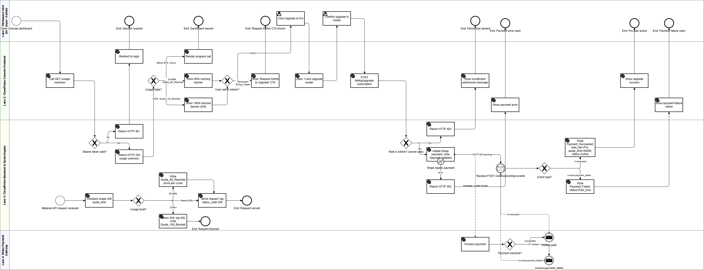
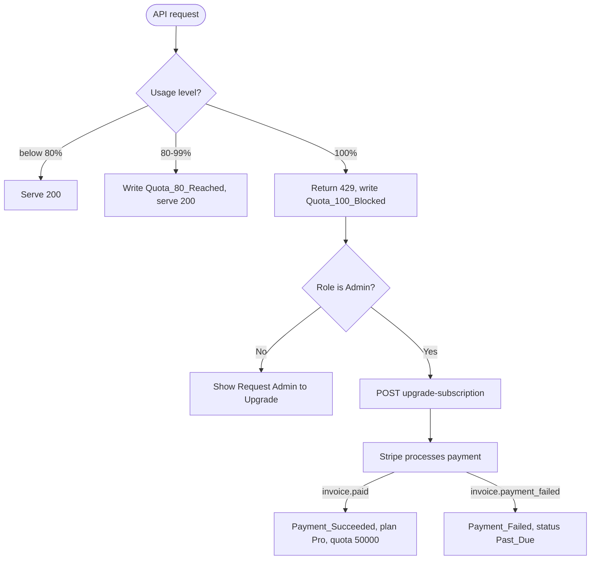
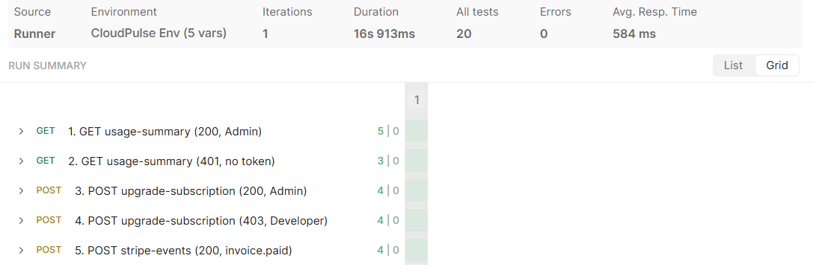
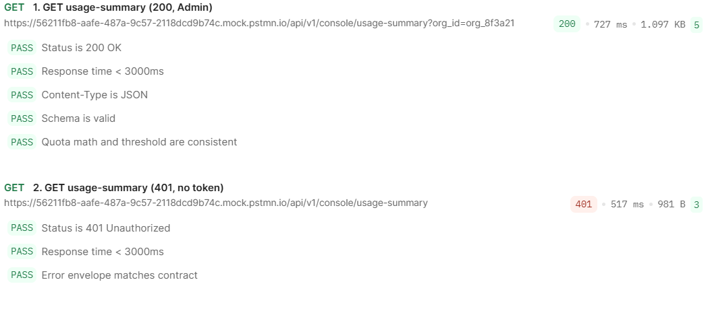
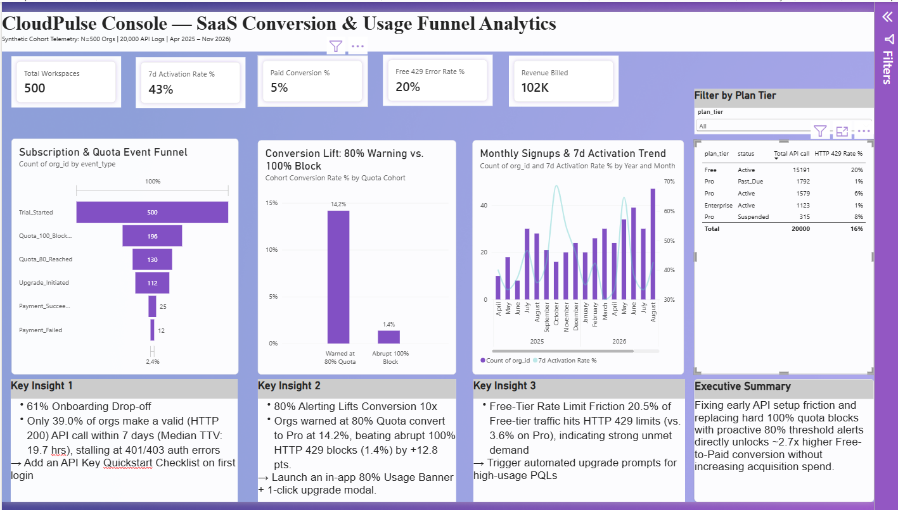

# CloudPulse Console: Fixing Onboarding Drop-off & Free-to-Paid Conversion

> **A product + data case study for a B2B SaaS API platform.**
> Role: Product / Business Analyst · Tools: PRD (RICE, JTBD, Gherkin), BPMN 2.0, REST/Postman, Python, PostgreSQL, Power BI

> ⚠️ **Transparency note:** CloudPulse is a *simulated* company. The business context (baselines, pricing, schema) comes from a case brief. All data in this repo is **synthetic**, generated by `data/generate_cloudpulse_data.py`, and some patterns (e.g. warned vs. abrupt conversion) were deliberately built in to demonstrate the analysis. Nothing here is a real-world result.

---

## 1. Overview

| | |
|---|---|
| **Product** | CloudPulse Console, an API & dashboard data service (Freemium + tiered usage-based pricing) |
| **Plans** | Free: 1,000 calls/mo · Pro: 50,000 calls/mo at $99 · Enterprise: custom |
| **My scope** | Problem framing → PRD → process design → API contract → test scripts → synthetic data → SQL analytics → BI dashboard |
| **Deliverables** | PRD · BPMN workflow · API spec + Postman collection · data generator · 5 SQL queries · Power BI blueprint |

## 2. Business Problem

1. **Onboarding drop-off:** 62% of registered workspaces never create an API key and make a first successful request within 7 days.
2. **Low Free-to-Paid conversion (2.1%):** Free users hit the quota (HTTP 429) with no warning and no self-serve upgrade path in the Console.

**Hypothesis:** Guide new workspaces to a first successful call, and warn Free workspaces before the limit with a one-click upgrade path for the right role. Then activation and conversion rise.

| Metric | Baseline | Target (90 days) |
|---|---|---|
| Activation (key + first HTTP 200 ≤ 7 days) | 38% | 55% |
| Free-to-Paid conversion | 2.1% | 3.5% |
| Time-to-first-API-call (median) | not instrumented | < 24 h |

## 3. Architecture & BPMN Diagrams

Four swimlanes: **Workspace User → Console Frontend → Backend & Quota Engine → Stripe**.


<!-- Export from Draw.io: File → Export as → PNG (200% scale). Source: docs/bpmn/CloudPulse_Quota_Upgrade_BPMN.drawio -->

Simplified logic (full diagram in `docs/bpmn/`):



## 4. PRD & API Spec Summary

**Prioritisation (RICE):** quarterly estimates based on stated assumptions.

| Feature | RICE | Decision |
|---|---|---|
| Interactive Onboarding Checklist | 4,000 | MVP |
| In-app Quota Bar & 80%/100% Alerts | 2,133 | MVP |
| 1-Click Upgrade Modal | 1,440 | MVP |
| PDF Invoice Exporter | 160 | Backlog |
| Custom SSO | 38 | Backlog |

**Personas:** Developer / Technical Lead (wants a working call in minutes) · Workspace Admin (owns budget, needs visibility and control).

**User stories (Gherkin acceptance criteria in `docs/PRD.md`):** quota tracking + 80% banner · hard block (429) + upgrade trigger · RBAC (only `Admin` can upgrade) · payment failure with 3-day grace.

**API contract** (`docs/api/`, Postman collection included):
**Postman Automated Test Execution (`docs/api/`):**



| Endpoint | Purpose | Key responses |
|---|---|---|
| `GET /api/v1/console/usage-summary` | Quota usage, remaining calls, reset date | 200, 401, 403, 402, 429 (rate limit) |
| `POST /api/v1/billing/upgrade-subscription` | Start Pro upgrade via Stripe | 200 (pending), 401, 403 (non-Admin), 402 (card declined) |
| `POST /api/v1/webhooks/stripe-events` | Handle `invoice.paid` / `invoice.payment_failed` | 200, 401 (bad signature) |

Design choices worth noting: Console endpoints are **exempt from quota metering** (otherwise a blocked workspace could not upgrade); RBAC is enforced **server-side**, not only in the UI; webhook handling is **idempotent**.

## 5. Key SQL Insights

`sql/cloudpulse_queries.sql` (PostgreSQL; CTEs, window functions) runs against the synthetic dataset:

| # | Analysis | Technique | Illustrative result (synthetic data) |
|---|---|---|---|
| 1 | Activation funnel | CTE flags, `LAG`, `FIRST_VALUE` | 500 → 345 invited → 191 first call → 179 hit 80% → 19 upgraded |
| 2 | Time-to-value cohorts | `PERCENTILE_CONT`, `LAG`, rolling `AVG` | Median ≈ 20 h from signup to first 200 |
| 3 | PQL scoring | Additive score, `RANK` | Ranked list of active Free orgs at 80–99% or > 5 429s/7d |
| 4 | 80% warning vs hard block | `ROW_NUMBER`, `LEAD`, last-touch attribution | 80%-warned orgs converted ~2.7× more per quota cycle |
| 5 | Payment failure & churn risk | `NTILE`, running window sum | Past_Due orgs ranked by MRR at risk and usage |

**Read this carefully:** Query 4's gap exists partly *because I built it into the generator*. In a real company it would be correlational (see caveats) and would need an A/B test to confirm.

## 6. Power BI Dashboard


<!-- Add a screenshot of the finished one-page report. Blueprint and DAX: docs/powerbi/ -->

Layout: top KPI cards (MRR, Activation %, Free-to-Paid %, 429 Rate %, NRR %) · left: funnel + TTV cohorts · right: quota events with 429 trend + PQL action table.

## 7. Strategic Recommendations

1. **Ship the MVP trio first:** onboarding checklist, quota alerts, one-click upgrade. They attack both problems and share one instrumentation effort.
2. **Instrument before optimising:** time-to-first-call and funnel-step events have no baseline today.
3. **Test, don't assume, the 80% threshold:** run an A/B test of 70/80/90% warnings with a holdout.
4. **Protect revenue with billing hygiene:** idempotent webhooks, a reconciliation job against Stripe, and the 3-day grace period.
5. **Feed Sales with PQLs:** route Hot-tier orgs to a human follow-up, since self-serve alone will not capture team-sized accounts.

## 8. Limitations & Honest Caveats

- Data is synthetic. Conversion is oversampled (~5% paid vs. 2.1% real) so the analysis has enough rows.
- The log table is a 20,000-row sample, so quota utilisation is read from metering events, not counted from logs.
- RICE reach/impact figures and the time-to-first-call baseline are planning assumptions to validate with real data.
- The warned-vs-abrupt comparison is not randomised; selection bias is possible.

## 9. Repository Structure

```
├── README.md
├── docs/
│   ├── PRD.docx
│   ├── bpmn/
│   │   └── CloudPulse_Quota_Upgrade_BPMN.drawio
│   ├── api/
│   │   ├── CloudPulse_API.postman_collection.json
│   │   └── CloudPulse_Mock.postman_environment.json
│   ├── powerbi/
│   │   └── B2B Saas.pbix
│   └── img/
│       ├── Dashboard.png
│       ├── PBMN pic.png
│       ├── eg_run_pass.png
│       ├── overview_run.png
│       └── run_summary.png
├── data/
│   ├── generate_cloudpulse_data.py
│   └── out/
└── sql/
    ├── cloudpulse_queries.sql
    └── run_sql.py
```

## 10. How to Reproduce

```bash
pip install pandas numpy
python data/generate_cloudpulse_data.py --out-dir data/out      # 4 CSVs
# PostgreSQL: run the DDL + \copy block at the top of sql/cloudpulse_queries.sql, then the queries
# Postman: import docs/api/CloudPulse_API.postman_collection.json and set the environment variables
```

---
**Author:** [Your Name] · [LinkedIn](https://linkedin.com/in/hieuvo825/) · [Email](vnmhieu080205@gmail.com)
